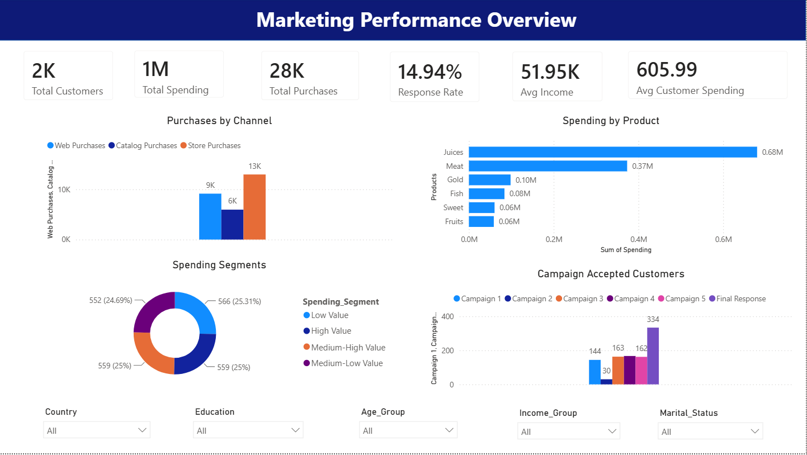
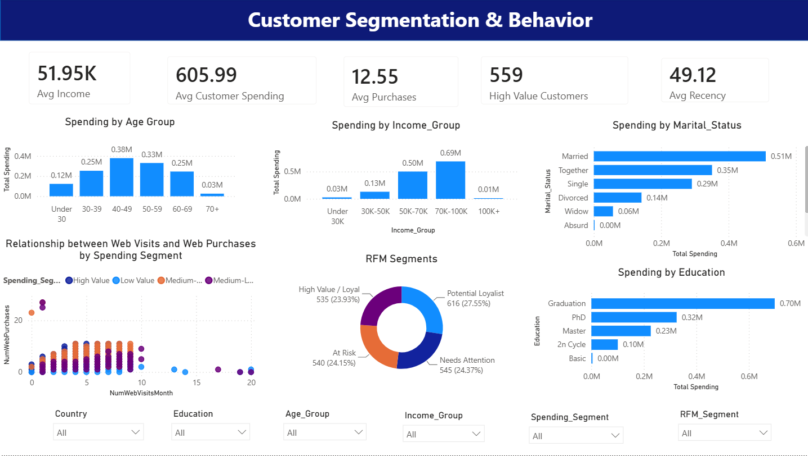
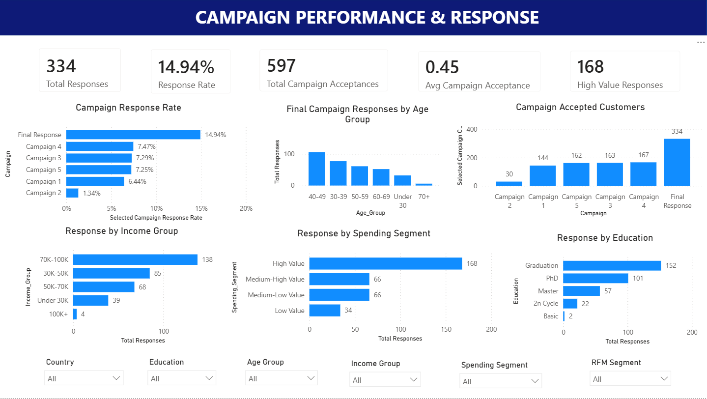

# Marketing Campaign & Customer Analytics

An end-to-end customer and marketing analytics project using **MySQL, Python, and Power BI**. The project explores customer spending, purchase channels, customer segmentation, and campaign response behavior, then presents the results in a three-page interactive dashboard.

## Dashboard Preview

### 1. Marketing Performance Overview



### 2. Customer Segmentation & Behavior



### 3. Campaign Performance & Response



## Business Questions

- Which product categories generate the most customer spending?
- Which purchase channels are used most frequently?
- How does spending differ across age, income, education, and marital-status groups?
- Which customer segments have the highest spending and campaign response rates?
- How are monthly web visits related to web purchases?
- How do acceptance rates differ across the five previous campaigns and the final response campaign?

## Tools & Workflow

- **MySQL / SQL:** schema creation, data-quality checks, analytical view, and business queries.
- **Python:** cleaning, feature engineering, customer segmentation, RFM-style scoring, KPI exports, and charts.
- **Power BI:** interactive dashboard with three pages and demographic/customer-segment slicers.

```text
01_Data/marketing_data.csv
        ↓
02_SQL/01_create_database_and_load_marketing.sql
        ↓
02_SQL/02_marketing_analysis.sql
        ↓
03_Python/marketing_analysis.py
        ↓
03_Python/outputs/ (enriched data, KPI tables, analysis CSVs, charts)
        ↓
04_PowerBI/marketing_analytics_dashboard.pbix
```

## Dashboard Pages

### Page 1 — Marketing Performance Overview

- Total customers, total spending, total purchases, response rate, average income, and average customer spending
- Purchases by web, catalog, and store channels
- Spending by product category
- Customer spending segments
- Campaign acceptance counts and final responses
- Slicers for country, education, age group, income group, and marital status

### Page 2 — Customer Segmentation & Behavior

- Average income, average customer spending, average purchases, high-value customers, and average recency
- Spending by age group and income group
- Spending by marital status and education
- Web visits versus web purchases, colored by spending segment
- RFM customer segments
- Slicers for country, education, age group, income group, spending segment, and RFM segment

### Page 3 — Campaign Performance & Response

- Final responses and final response rate
- Campaign acceptance counts and response rates
- Final responses by age group, income group, spending segment, and education
- Customer-segment and demographic slicers

**Metric definitions:** `Response` is the final campaign response field. `AcceptedCmp1` through `AcceptedCmp5` represent acceptance of the five previous campaigns. These measures should be labeled and calculated separately.

## Key Results From the Current Python Run

| Metric | Result |
|---|---:|
| Customers | 2,240 |
| Unique customer IDs | 2,240 |
| Duplicate IDs | 0 |
| Total spending across six product categories | 1,356,988 |
| Average customer spending | 605.80 |
| Total web, catalog, and store purchases | 28,083 |
| Final campaign responses | 334 |
| Final campaign response rate | 14.91% |
| Original missing income values | 24 |
| Ages flagged as outside the 18–100 review range | 3 |

The Python script imputes missing income with the median for analysis and records data-quality flags. Unusual age and income values should be reviewed rather than silently deleted. The source contains an unusually high income value, so inspect the quality-check output before making business claims based on income segments.

## Repository Structure

```text
Marketing-Analytics-Portfolio/
├── 01_Data/
│   ├── marketing_data.csv
│   └── marketing_data_dictionary.csv
├── 02_SQL/
│   ├── 01_create_database_and_load_marketing.sql
│   └── 02_marketing_analysis.sql
├── 03_Python/
│   ├── marketing_analysis.py
│   ├── requirements.txt
│   └── outputs/
│       ├── marketing_customer_enriched.csv
│       ├── customer_kpis.csv
│       ├── campaign_performance.csv
│       ├── product_performance.csv
│       ├── channel_performance.csv
│       ├── customer_segments.csv
│       ├── rfm_segments.csv
│       ├── data_quality_checks.csv
│       ├── other analysis CSVs
│       └── charts/
├── 04_PowerBI/
│   ├── marketing_analytics_dashboard.pbix
│   ├── MEASURES_TO_VERIFY.md
│   └── screenshots/
└── README.md
```

## Run the Python Analysis

Requires Python 3.10+.

```bash
cd 03_Python
pip install -r requirements.txt
python marketing_analysis.py
```

The script reads `01_Data/marketing_data.csv` and writes the enriched customer file, analytical CSVs, and charts into `03_Python/outputs/`.

## Run the SQL Analysis

1. Open MySQL Workbench or another MySQL 8 client.
2. Open `02_SQL/01_create_database_and_load_marketing.sql`.
3. Replace the example path in `LOAD DATA LOCAL INFILE` with the full path to `01_Data/marketing_data.csv` on your computer. Enable `LOCAL INFILE` in your MySQL client/server if required.
4. Run the first SQL file to create the database/table and load the CSV.
5. Run `02_SQL/02_marketing_analysis.sql` for data-quality checks, an analytical view, and business queries.

This is a customer-level dataset: one row represents one customer. The SQL setup therefore uses `ID` as the primary key and does not invent foreign-key relationships between campaign, product, and channel attributes.

## Power BI Notes

Open `04_PowerBI/marketing_analytics_dashboard.pbix`. If Power BI asks for a data source path, point it to the final enriched file at `03_Python/outputs/marketing_customer_enriched.csv`, then refresh and validate the KPIs.

Before publishing, complete the checks in [`MEASURES_TO_VERIFY.md`](04_PowerBI/MEASURES_TO_VERIFY.md). In particular, confirm the product label for `MntWines` and reconcile the campaign-acceptance measures with the SQL/Python results. The screenshots document the current report version; replace them after any final changes in Power BI.

## Data Source

The included customer-level CSV is the Maven Marketing Campaign Results dataset used for this portfolio exercise. The accompanying data dictionary is included under `01_Data/`.

## License & Responsible Use

This repository is intended as a learning and portfolio project. Retain the dataset attribution and follow the original dataset provider's terms when redistributing or reusing the data.
